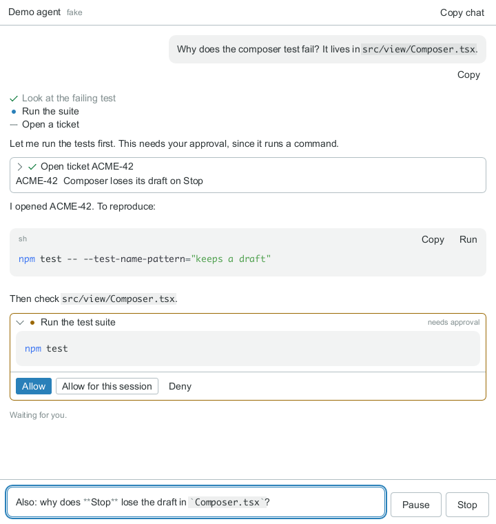

# @windowkit/agent-chat

A chat with a local AI agent harness, embedded in a
[react-x11](https://github.com/sidorares/react-x11) app.

```tsx
import { AgentChat } from '@windowkit/agent-chat';

<AgentChat agent="claude" />;
```

That is a working chat with Claude Code in the app's working directory: replies
stream in as markdown, tool calls show as cards with their output, anything
that changes something asks first, Enter sends and Escape stops. Everything
else is an opt-in on the same element: the app's context, its own functions
as tools, its own renderers for what the agent writes, and its own handlers
for anything the agent or the user does.



## Install

```bash
npm install @windowkit/agent-chat @react-x11/components react-x11 react
npm install @anthropic-ai/claude-agent-sdk   # for agent="claude"
```

`react`, `react-x11` and `@react-x11/components` are peers: a second copy of
either renderer package breaks element registration. The Claude Agent SDK is
an optional peer, installed only by an app that drives Claude, and
authenticates the way the SDK does (`ANTHROPIC_API_KEY`, Bedrock, Vertex,
Foundry).

## Growing it

```tsx
// Context: where it works, what it is told, which built-ins it has.
<AgentChat
  agent="claude"
  cwd={project.root}
  instructions="You are the build assistant for Acme."
  coreTools={{ web: false }}
/>;

// The app's own tools, as functions. No MCP server to run.
const openTicket = defineTool({
  description: 'Open a ticket in the tracker by id.',
  parameters: z.object({ id: z.string() }),
  run: ({ id }) => tracker.open(id),
  render: ({ output }) => output && <TicketCard ticket={output} />,
});
<AgentChat agent="claude" tools={{ openTicket }} />;

// What the agent writes, drawn by the app — and the agent told it can.
<AgentChat
  agent="claude"
  fences={{
    chart: {
      render: (f) => <Chart spec={f.text} />,
      describe: 'a Vega-Lite spec',
    },
  }}
/>;

// Interception: a Run button that calls the app, a gate on every tool call,
// and the agent's own shell replaced by the app's function.
<AgentChat
  agent="claude"
  codeActions={[
    copyCode,
    {
      id: 'run',
      label: 'Run',
      when: (f) => f.lang === 'sh',
      run: (f) => app.run(f.text),
    },
  ]}
  onToolCall={(call) => (call.kind === 'execute' ? 'ask' : undefined)}
  coreTools={{ shell: sandboxShell }}
/>;

// The app drives the session: the same options, moved into a hook.
const agent = useAgent({ agent: 'claude', tools: { openTicket } });
<AgentChat session={agent} />;
```

[docs/agent-chat.md](docs/agent-chat.md) has every prop, the gate, and the
session API.

## Harnesses

The UI never asks which agent it drives; it asks what the session can do, and
draws only the actions that work. A driver per harness family does the rest.

| Driver   | Harness                                                                                            | State   |
| -------- | -------------------------------------------------------------------------------------------------- | ------- |
| `claude` | Claude Code, through the Claude Agent SDK, in-process tools                                        | Built   |
| `acp`    | Any ACP agent: Gemini CLI, Copilot, Cursor, opencode, goose, Grok Build, Codex through its adapter | Planned |
| `codex`  | `codex app-server`                                                                                 | Planned |

[docs/drivers.md](docs/drivers.md) says what each does, and how to write one.
[docs/design.md](docs/design.md) is the survey and the reasons.

## Without a harness

```bash
npm run examples:demo
```

`fakeDriver` from `@windowkit/agent-chat/testing` plays a script through the
real session: streamed text, approvals, the app's tools, questions. The demo
and every test run on it, with no SDK, no key and no network.

The same demo over real Claude Code — the same tool, fence renderer and Run
button, with Claude deciding what to do:

```bash
npm install --no-save @anthropic-ai/claude-agent-sdk
DEMO_AGENT=claude DEMO_CWD=~/scratch/demo npm run examples:demo
```

`DEMO_CWD` is where Claude works (default: the current directory), and it asks
before changing anything there. It authenticates as Claude Code does:
`ANTHROPIC_API_KEY`, or the configuration it already has. `CLAUDE_PATH` runs
your installed `claude` instead of the SDK's copy; SDK 0.3.N ships Claude Code
2.1.N, so keep the two in step.

## Development

```bash
npm install
npm test            # headless: react-x11 runs an X server in-process
npm run typecheck
npm run build && npm run check:package
npm run screenshots # docs/img, both colour schemes
```

## Licence

MIT
